# Manual de Usuario - GoDisk (ExtreamFS)

## Sistema de Archivos EXT2 Simulado

---

## Tabla de Contenidos

1. [Introducción](#introducción)
2. [Requisitos del Sistema](#requisitos-del-sistema)
3. [Instalación y Configuración](#instalación-y-configuración)
4. [Interfaz de Usuario](#interfaz-de-usuario)
5. [Guía de Comandos](#guía-de-comandos)
6. [Ejemplos Prácticos](#ejemplos-prácticos)
7. [Generación de Reportes](#generación-de-reportes)
8. [Resolución de Problemas](#resolución-de-problemas)
9. [Preguntas Frecuentes](#preguntas-frecuentes)

---

## 1. Introducción

ExtreamFS es una aplicación web que simula un sistema de archivos EXT2, permitiendo la creación y administración de discos virtuales, particiones, archivos y usuarios. La aplicación consta de un backend desarrollado en Go y un frontend interactivo que facilita la gestión del sistema de archivos desde cualquier navegador web.

### Características Principales

- Simulación completa del sistema de archivos EXT2
- Gestión de discos virtuales mediante archivos .mia
- Administración de particiones (primarias, extendidas y lógicas)
- Sistema completo de usuarios y grupos
- Creación y manejo de archivos y carpetas
- Generación de reportes visuales con Graphviz
- Ejecución de scripts de comandos (.smia)

---

## 2. Requisitos del Sistema

### Requisitos Mínimos

- **Sistema Operativo:** GNU/Linux o MacOS
- **Memoria RAM:** 4 GB mínimo, 8 GB recomendado
- **Espacio en Disco:** 2 GB libres
- **Navegador Web:** Chrome 90+, Firefox 88+, Safari 14+

### Software Requerido

- Go (Golang) 1.19 o superior
- Node.js 16+ (para el frontend)
- Graphviz (para generación de reportes)

---

## 3. Instalación y Configuración

### Paso 1: Clonar el Repositorio

```bash
git clone https://github.com/DiegVas/MIA_2S2025_P1_202300638.git
cd MIA_2S2025_P1_carnet
```

### Paso 2: Configurar el Backend

```bash
cd backend
go run main.go
```

### Paso 3: Configurar el Frontend

```bash
cd ../frontend
npm install
npm run dev
```

### Paso 4: Verificar la Instalación

Abrir el navegador web y navegar a `http://localhost:5173`

**[IMAGEN: Pantalla de inicio de la aplicación]**
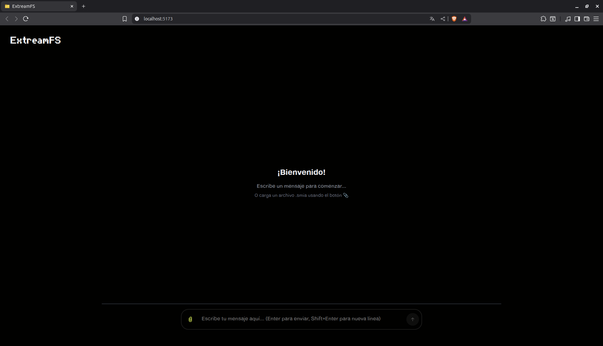

---

## 4. Interfaz de Usuario

### Descripción General

La interfaz principal de GoDisk consta de dos áreas principales:

**[IMAGEN: Interfaz principal completa]**
*Captura de pantalla mostrando la interfaz completa con ambas áreas*

### Área de Entrada de Comandos

Ubicada en la parte superior, permite:

- Escribir comandos manualmente
- Cargar archivos de script (.smia)
- Ejecutar comandos individualmente o en lote

**[IMAGEN: Área de entrada de comandos]**
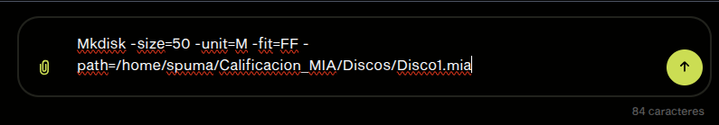

#### Botones de Control

- **Cargar Script:** Permite seleccionar un archivo .smia
- **Ejecutar:** Procesa todos los comandos en el área de entrada
- **Limpiar:** Borra el contenido del área de entrada

**[IMAGEN: Botones de control]**
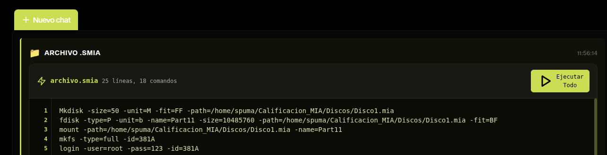

### Área de Salida de Comandos

Ubicada en la parte inferior, muestra:

- Resultados de la ejecución de comandos
- Mensajes de error y advertencias
- Confirmaciones de operaciones exitosas
- Comentarios del script (líneas que inician con #)

**[IMAGEN: Área de salida con resultados]**
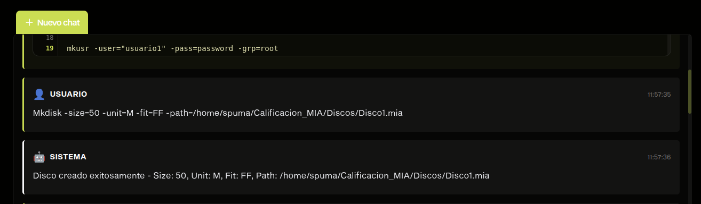

---

## 5. Guía de Comandos

### 5.1 Administración de Discos

#### MKDISK - Crear Disco Virtual

Crea un archivo binario que simula un disco duro.

**Sintaxis:**

```
mkdisk -size=<tamaño> -unit=<K|M> -path=<ruta> -fit=<BF|FF|WF>
```

**Parámetros:**

- `-size`: Tamaño del disco (obligatorio)
- `-unit`: Unidades K (Kilobytes) o M (Megabytes) (opcional, por defecto M)
- `-path`: Ruta donde crear el disco (obligatorio)
- `-fit`: Tipo de ajuste BF/FF/WF (opcional, por defecto FF)

**Ejemplo de uso:**

**[IMAGEN: Comando mkdisk en ejecución]**
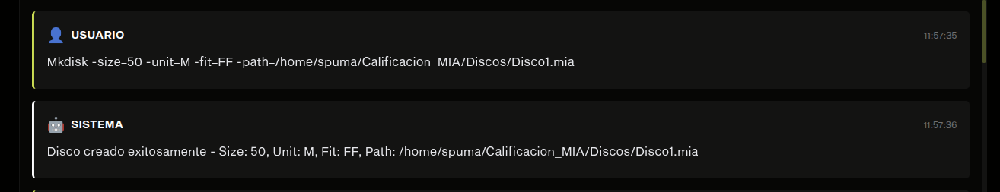

```
mkdisk -size=10 -unit=M -path="/home/user/disco1.mia"
```

#### RMDISK - Eliminar Disco

Elimina un archivo de disco virtual.

**Sintaxis:**

```
rmdisk -path=<ruta>
```

**Ejemplo:**

**[IMAGEN: Comando rmdisk]**
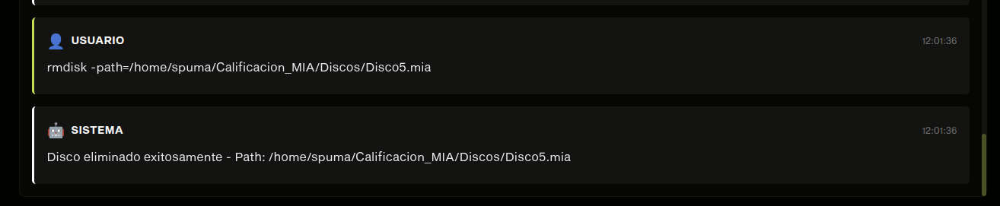
```
rmdisk -path="/home/user/disco1.mia"
```

### 5.2 Administración de Particiones

#### FDISK - Gestionar Particiones

Crea particiones primarias, extendidas o lógicas.

**Sintaxis:**

```
fdisk -size=<tamaño> -path=<ruta> -name=<nombre> -type=<P|E|L> -fit=<BF|FF|WF> -unit=<B|K|M>
```

**Ejemplos:**

**Crear partición primaria:**

**[IMAGEN: Creando partición primaria]**
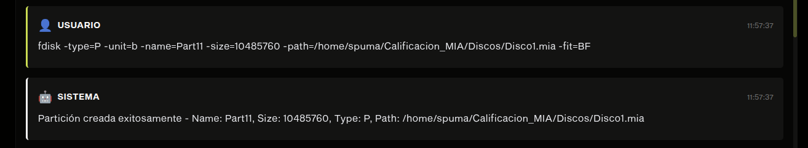
```
fdisk -size=300 -path="/home/user/disco1.mia" -name="Particion1" -type=P
```

**[IMAGEN: Resultado partición primaria]**
*Captura del resultado exitoso*

**Crear partición extendida:**

```
fdisk -size=500 -path="/home/user/disco1.mia" -name="Extendida1" -type=E
```

### 5.3 Montaje de Particiones

#### MOUNT - Montar Partición

Monta una partición en el sistema asignándole un ID único.

**Sintaxis:**

```
mount -path=<ruta> -name=<nombre_particion>
```

**Ejemplo:**

```
mount -path="/home/user/disco1.mia" -name="Particion1"
```

**[IMAGEN: Resultado mount con ID]**
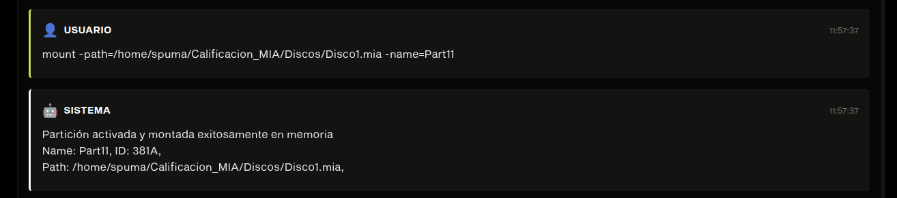
#### MOUNTED - Listar Particiones Montadas

Muestra todas las particiones actualmente montadas.

**[IMAGEN: Comando mounted]**
*Captura del comando mounted y su resultado*

```
mounted
```

### 5.4 Sistema de Archivos

#### MKFS - Formatear Partición

Formatea una partición montada con el sistema EXT2.

**Sintaxis:**

```
mkfs -id=<id_particion> -type=<full>
```

**Ejemplo:**

**[IMAGEN: Comando mkfs]**
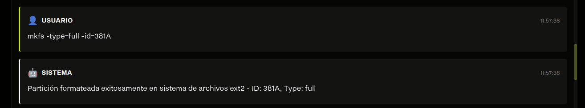
```
mkfs -id=341A -type=full
```


### 5.5 Gestión de Usuarios

#### LOGIN - Iniciar Sesión

Inicia sesión en el sistema con un usuario específico.

**Sintaxis:**

```
login -user=<usuario> -pass=<contraseña> -id=<id_particion>
```

**Ejemplo:**

**[IMAGEN: Login como root]**
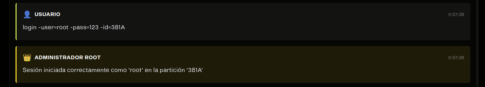

```
login -user=root -pass=123 -id=341A
```

#### LOGOUT - Cerrar Sesión

**[IMAGEN: Comando logout]**
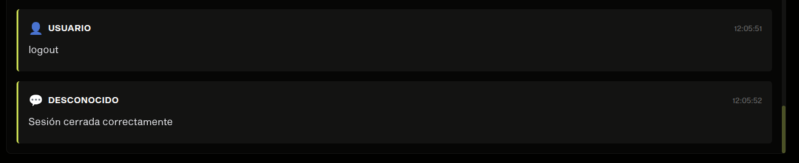
```
logout
```

### 5.6 Administración de Grupos y Usuarios

#### MKGRP - Crear Grupo

Solo disponible para el usuario root.

**[IMAGEN: Creando grupo]**
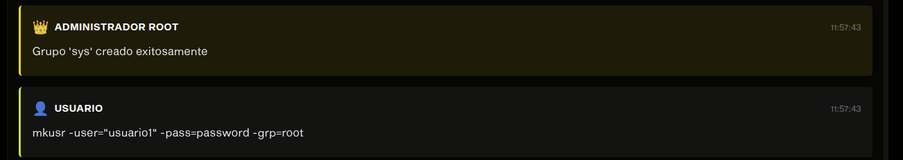

```
mkgrp -name=estudiantes
```

#### MKUSR - Crear Usuario

**[IMAGEN: Creando usuario]**
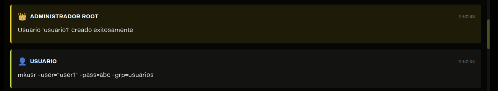

```
mkusr -user=juan -pass=1234 -grp=estudiantes
```

### 5.7 Manejo de Archivos y Carpetas

#### MKDIR - Crear Carpeta

**Sintaxis:**

```
mkdir -path=<ruta> -p
```

**Ejemplo:**

**[IMAGEN: Comando mkdir]**
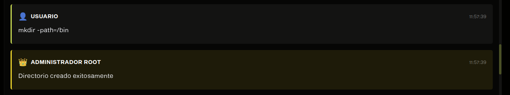

```
mkdir -path="/home/documentos" -p
```

#### MKFILE - Crear Archivo

**Sintaxis:**

```
mkfile -path=<ruta> -size=<tamaño> -cont=<archivo_origen> -r
```

**Ejemplos:**

**Crear archivo con tamaño específico:**

**[IMAGEN: Comando mkfile con size]**

```
mkfile -path="/home/archivo1.txt" -size=100 -r
```

**Crear archivo con contenido:**

**[IMAGEN: Comando mkfile con contenido]**

```
mkfile -path="/home/datos.txt" -cont="/home/local/datos.txt" -r
```

#### CAT - Mostrar Contenido

**[IMAGEN: Comando cat]**
*Captura del comando cat mostrando contenido de archivo*

```
cat -file1="/home/archivo1.txt"
```

**[IMAGEN: Resultado cat]**
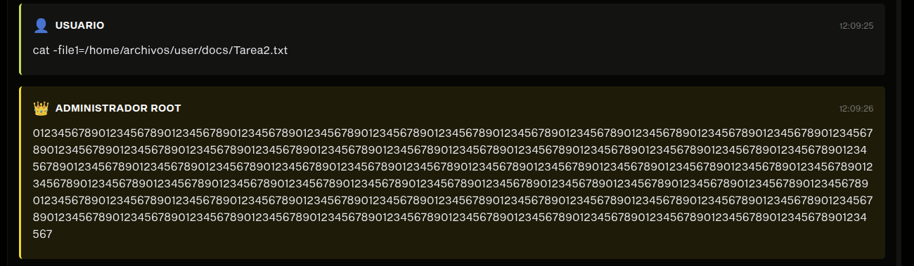
---

## 6. Ejemplos Prácticos

### Ejemplo 1: Creación Completa de un Sistema

**Paso 1: Crear el disco**

```
mkdisk -size=20 -unit=M -path="/home/proyecto/disco.mia"
```

**Paso 2: Crear particiones**

```
fdisk -size=10 -unit=M -path="/home/proyecto/disco.mia" -name="SO" -type=P
fdisk -size=8 -unit=M -path="/home/proyecto/disco.mia" -name="Extendida" -type=E
fdisk -size=3 -unit=M -path="/home/proyecto/disco.mia" -name="Datos" -type=L
```

**Paso 3: Montar y formatear**


```
mount -path="/home/proyecto/disco.mia" -name="SO"
mkfs -id=341A -type=full
```

**Paso 4: Crear estructura de directorios**


```
login -user=root -pass=123 -id=341A
mkdir -path="/home" -p
mkdir -path="/var" -p
mkdir -path="/etc" -p
```

### Ejemplo 2: Carga de Script

**Creación del archivo script.smia:**

**[IMAGEN: Archivo script.smia]**
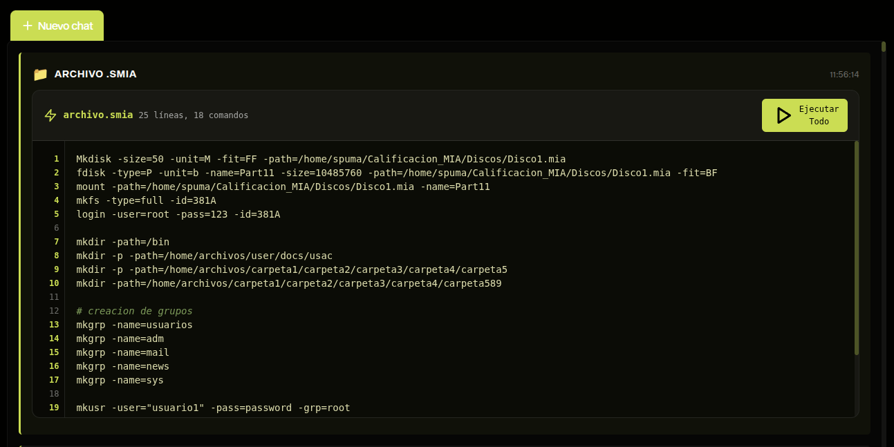

```
# Script de configuración inicial
mkdisk -size=15 -unit=M -path="/home/test/disco_test.mia"
fdisk -size=10 -unit=M -path="/home/test/disco_test.mia" -name="Principal" -type=P
mount -path="/home/test/disco_test.mia" -name="Principal"
mkfs -id=341A -type=full
login -user=root -pass=123 -id=341A
mkgrp -name=usuarios
mkusr -user=admin -pass=admin123 -grp=usuarios
```

---

## 7. Generación de Reportes

### Comando REP

Genera reportes visuales del sistema de archivos.

**Sintaxis:**

```
rep -name=<tipo_reporte> -path=<ruta_salida> -id=<id_particion> -path_file_ls=<ruta_archivo>
```

### Tipos de Reportes

#### Reporte MBR

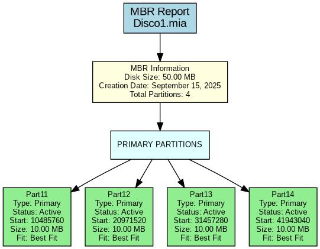
```
rep -name=mbr -path="/home/reportes/mbr.jpg" -id=341A
```

**[IMAGEN: Resultado reporte MBR]**
*Captura del archivo generado mostrando la estructura MBR*

#### Reporte DISK

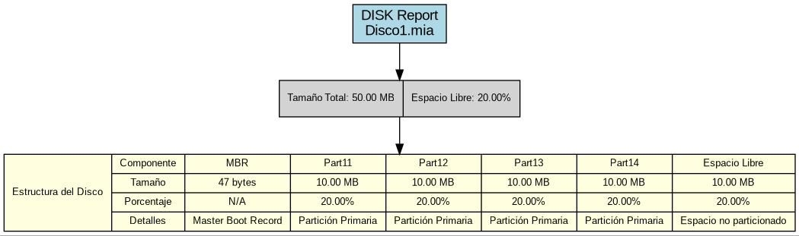
```
rep -name=disk -path="/home/reportes/disk.jpg" -id=341A
```

#### Reporte TREE

**[IMAGEN: Comando reporte TREE]**

```
rep -name=tree -path="/home/reportes/tree.jpg" -id=341A
```

**[IMAGEN: Resultado reporte TREE]**


#### Reportes de Texto (Bitmaps)

**[IMAGEN: Reporte bitmap inodos]**

```
rep -name=bm_inode -path="/home/reportes/bitmap_inodos.txt" -id=341A
```
---

## 8. Resolución de Problemas

### Problemas Comunes y Soluciones

#### Error: "Comando no reconocido"

**Síntoma:** El sistema no reconoce un comando ingresado.

**[IMAGEN: Error comando no reconocido]**
*Captura del mensaje de error*

**Solución:**

- Verificar la sintaxis del comando
- Asegurar que todos los parámetros obligatorios estén presentes
- Revisar que no haya espacios extra

#### Error: "Partición no encontrada"

**Síntoma:** Error al intentar montar o acceder a una partición.

**[IMAGEN: Error partición no encontrada]**

**Solución:**

- Verificar que la partición existe con el comando `mounted`
- Confirmar que el nombre de la partición es correcto
- Asegurar que el disco existe

#### Error: "Sin sesión activa"

**Síntoma:** Comandos que requieren sesión fallan.
*

**Solución:**

- Ejecutar `login` con credenciales válidas
- Verificar que la partición esté montada y formateada

#### Error: "Permisos insuficientes"

**Síntoma:** No se puede ejecutar una operación por permisos.


**Solución:**

- Verificar que el usuario tenga los permisos necesarios
- Para operaciones administrativas, usar el usuario root

### Verificación del Estado del Sistema

#### Comando de Diagnóstico


```
mounted
login -user=root -pass=123 -id=341A
cat -file1="/users.txt"
```

---

## 9. Preguntas Frecuentes

### ¿Cómo puedo verificar si mi disco se creó correctamente?

Utiliza el reporte MBR para visualizar la estructura:


```
rep -name=mbr -path="/tmp/verificacion.jpg" -id=341A
```

### ¿Qué hago si se llena mi partición?

Puedes crear una nueva partición o redimensionar la existente (requiere recrear el disco).

### ¿Cómo recupero el contenido si pierdo la sesión?

Los datos permanecen en el disco virtual. Solo necesitas hacer login nuevamente:


```
mount -path="/ruta/disco.mia" -name="nombre_particion"
login -user=tu_usuario -pass=tu_contraseña -id=ID_ASIGNADO
```

### ¿Puedo usar espacios en nombres de archivos o rutas?

Sí, pero debes encerrar la ruta completa entre comillas dobles:


```
mkdir -path="/home/mis documentos/proyecto final" -p
```

---

## Notas Adicionales

- Los archivos .mia no deben moverse manualmente del sistema operativo
- Siempre hacer logout antes de cerrar la aplicación
- Los reportes se generan en tiempo real basados en el estado actual
- Mantener respaldos de los scripts importantes (.smia)

---
